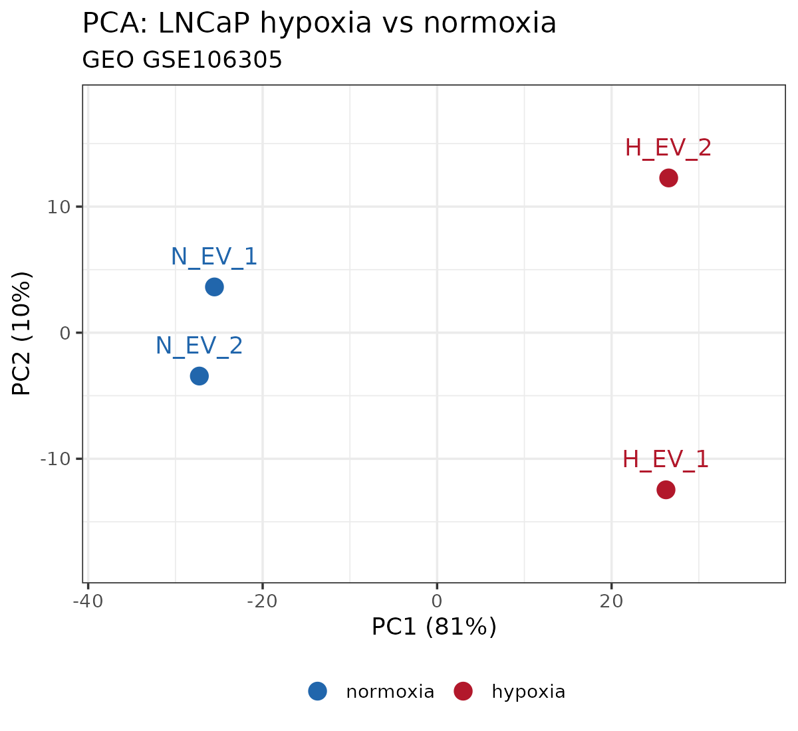
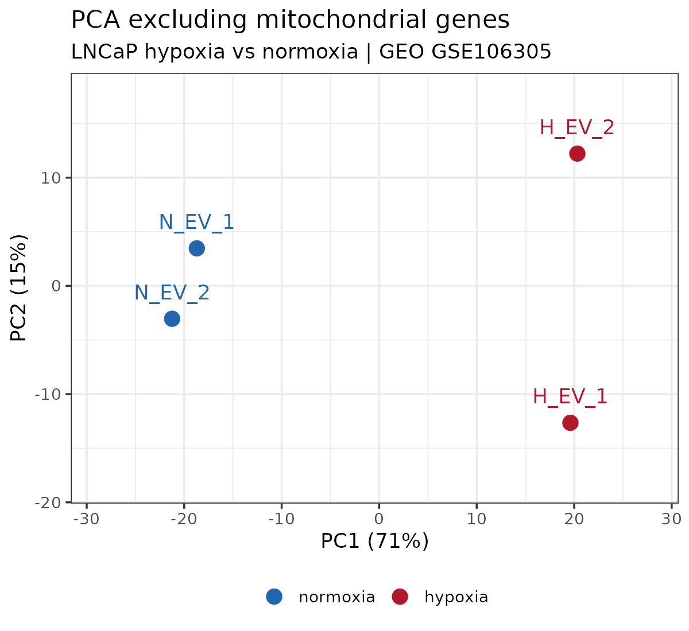
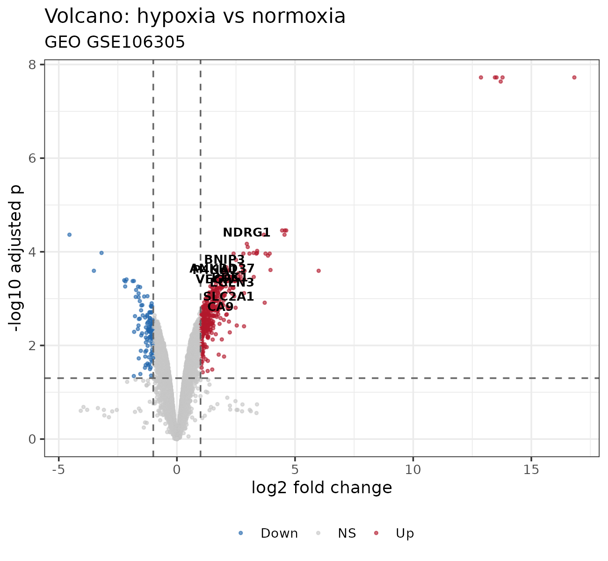

# Snakemake Hypoxia-Related Transcriptome Changes in Prostate Cancer


A reproducible Snakemake workflow for analyzing hypoxia-associated
gene-expression changes in LNCaP prostate cancer cells using GEO dataset
GSE106305, R, and limma.

## Research Team

**Horizon Science Communication LLC — Bioinformatics Team**

**- Alaa Elmansy**

**- Dr. Abeer Dsouky**

**- Dr. Hesham Abdullah**

**- Mohamed Elsisi**

## Project Background

Tumor hypoxia can alter transcriptional programs involved in cellular
adaptation, metabolism, and stress responses. This project examines
gene-expression differences between hypoxia and normoxia in LNCaP
prostate cancer cells using a publicly available processed RNA-seq
expression matrix.

**Dataset:** [GEO: GSE106305](https://www.ncbi.nlm.nih.gov/geo/query/acc.cgi?acc=GSE106305)

## Project Objectives

The workflow is designed to:

-   Prepare and filter the processed expression matrix for the selected
    samples.
-   Identify differentially expressed genes between hypoxia and
    normoxia.
-   Examine the expression of predefined HIF-associated target genes.
-   Generate PCA, volcano-plot, and heatmap visualizations.
-   Assess the sensitivity of the differential-expression results to
    excluding mitochondrial genes.
-   Provide a reproducible workflow with rule-specific Conda
    environments.

## Dataset Overview

The analysis uses the processed gene-expression matrix from GEO dataset [GSE106305](https://www.ncbi.nlm.nih.gov/geo/query/acc.cgi?acc=GSE106305) to investigate hypoxia-related transcriptomic changes in LNCaP prostate cancer cells.

| Attribute | Description |
|---|---|
| **GEO accession** | GSE106305 |
| **Cell line** | LNCaP prostate cancer cells |
| **Experimental comparison** | Empty-vector cells under hypoxia vs. normoxia |
| **Input data** | Processed RPKM gene-expression matrix |
| **Total samples** | 4 |
| **Biological replicates** | 2 per condition |
| **Differential expression analysis** | `limma` with empirical Bayes moderation and trend |
| **Workflow management** | Snakemake |
| **Programming language** | R |
| **Environment management** | Conda |

### Sample design

| Sample ID | Condition |
|---|---|
| `N_EV_1` | Normoxia |
| `N_EV_2` | Normoxia |
| `H_EV_1` | Hypoxia |
| `H_EV_2` | Hypoxia |

The workflow downloads the processed GEO supplementary expression matrix
as needed. Raw sequencing reads are not required for the current
analysis and are not included in this repository.

## Why Snakemake?


Snakemake organizes the analysis into explicit rules with defined inputs
and outputs. It helps make the workflow reproducible by tracking file
dependencies, rerunning steps when inputs or rule definitions change,
and creating software environments from the Conda manifests.

This project uses Snakemake for:

-   **Workflow orchestration:** coordinates downloading, expression
    preparation, differential expression, and visualization.
-   **Dependency tracking:** reruns downstream steps when upstream files
    change.
-   **Environment management:** provisions separate Conda environments
    for downloading and R-based analysis.
-   **Reproducibility:** keeps analysis scripts, parameters, and
    workflow definitions under version control.
-   **Validation:** supports workflow linting and checks whether
    requested outputs are up to date.

## Workflow Overview

``` text
GEO processed RPKM expression matrix
                |
                v
       Download expression data
                |
                v
        Prepare expression matrix
   (sample selection, filtering, log2)
                |
                v
      Differential expression (limma)
                |
        +-------+--------+
        |       |        |
        v       v        v
       PCA   Volcano   Heatmap
                |
                v
       Summary and result tables

Separate sensitivity analysis:
Exclude MT- genes -> limma differential expression
```

The default workflow generates the primary differential-expression
results, PCA, volcano plot, heatmap, and summary. The
mitochondrial-exclusion sensitivity analysis is available as a separate
rule.

## Repository Structure

``` text
Hypoxia-Related-Transcriptome-Changes-in-Prostate-Cancer/
├── Snakefile
├── README.md
├── .gitignore
├── LICENSE
├── config/
│   └── config.yaml
├── envs/
│   ├── download.yaml
│   └── r.yaml
├── scripts/
│   ├── prepare.R
│   ├── de.R
│   ├── de_no_mito.R
│   ├── pca.R
│   ├── pca_no_mito.R
│   ├── volcano.R
│   └── heatmap.R
└── results/
    ├── expression_log2.csv
    ├── samples.csv
    ├── DE_results.csv
    ├── DE_significant.csv
    ├── DE_results_no_mito.csv
    ├── DE_significant_no_mito.csv
    ├── summary.txt
    ├── PCA.png
    ├── PCA_no_mito.png
    ├── volcano.png
    └── heatmap_top30.png
```

The downloaded compressed input file and Snakemake working directory are
excluded from version control. The `results/` directory contains
selected processed tables and figures for inspection.

## Results

In the current analysis:

-   **Genes tested:** 11,661
-   **Significant genes:** 567
-   **Upregulated in hypoxia:** 445
-   **Downregulated in hypoxia:** 122
-   **Predefined HIF-associated targets significantly upregulated:** 17
    of 20

Significance was defined as an adjusted p-value below 0.05 and an
absolute log2 fold change greater than 1. These values describe the
current run and may change if the input data, configuration, or analysis
code changes.

### 1. Principal Component Analysis

PCA is used to visualize sample-level expression patterns using the most
variable genes.



A separate PCA excludes genes whose symbols begin with `MT-`:



### 2. Differential-Expression Volcano Plot

The volcano plot summarizes estimated log2 fold changes and adjusted
p-values from the primary limma analysis.



### 3. Heatmap

The heatmap displays expression patterns for the top differentially
expressed genes.


### 4. Result Tables

| Output | Description |
|---|---|
| `results/DE_results.csv` | Complete primary differential-expression results |
| `results/DE_significant.csv` | Genes passing the configured significance thresholds |
| `results/DE_results_no_mito.csv` | Differential-expression results after excluding `MT-` genes |
| `results/DE_significant_no_mito.csv` | Significant genes from the mitochondrial-exclusion analysis |
| `results/expression_log2.csv` | Prepared log2 expression matrix |
| `results/samples.csv` | Sample metadata used in the analysis |
| `results/summary.txt` | Summary statistics and selected top genes |


## Mitochondrial Sensitivity Analysis

A separate analysis excludes genes with symbols beginning with `MT-` and
repeats the differential-expression analysis using the same model and
thresholds.

The primary analysis identified 567 significant genes. The
mitochondrial-exclusion analysis identified 557 significant genes. The
10 significant genes not retained in the sensitivity analysis were
mitochondrial genes; the other significant findings overlapped.

This sensitivity check suggests that the non-mitochondrial findings are
robust to this specific exclusion. It does **not** establish why the
mitochondrial expression values are unusual or rule out every possible
technical bias.

## Reproducing the Analysis

### Requirements

-   Linux or a compatible Unix-like environment
-   Conda
-   Snakemake
-   `curl` (provided by the download rule's Conda environment)
-   R packages specified in `envs/r.yaml`

### 1. Clone the repository

``` bash
git clone https://github.com/MohamedElsisii/Hypoxia-Related-Transcriptome-Changes-in-Prostate-Cancer.git
cd Hypoxia-Related-Transcriptome-Changes-in-Prostate-Cancer
```

### 2. Install Snakemake

If needed, create a dedicated Conda environment:

``` bash
conda create -n snakemake -c conda-forge -c bioconda snakemake
conda activate snakemake
```

### 3. Run the workflow

``` bash
snakemake --use-conda --cores 2
```

Snakemake downloads the processed expression matrix when required,
creates the rule-specific Conda environments, and generates the default
outputs.

### 4. Run the mitochondrial sensitivity analysis

``` bash
snakemake --use-conda --cores 2 de_no_mito
```

### 5. Validate the workflow

``` bash
snakemake --lint
snakemake --use-conda --cores 2
```

The lint command checks the workflow for common issues. A subsequent run
should report that there is nothing to do when all requested outputs are
present and up to date.

## Methods and Interpretation

The input is a processed RPKM matrix rather than raw sequencing counts.
The workflow selects the four samples listed above, removes rows with
missing values, filters genes using the configured mean-RPKM threshold,
and log2-transforms expression values before differential-expression
analysis.

Differential expression is calculated with limma using empirical Bayes
moderation and a trend-aware variance model. The primary analysis
compares hypoxia with normoxia. The mitochondrial sensitivity analysis
repeats the comparison after excluding `MT-` genes.

## Limitations

-   The analysis includes only two biological samples per condition,
    which limits statistical power and the ability to characterize
    biological variability.
-   The workflow uses processed RPKM values, not raw sequencing counts
    or raw FASTQ reads.
-   Several mitochondrial genes have unusually large expression
    differences in the processed matrix. The available data do not
    establish whether these patterns are biological or technical.
-   The sensitivity analysis tests the effect of excluding mitochondrial
    genes but cannot, by itself, resolve the origin of the unusual
    values.
-   Findings from this cell-line comparison should not automatically be
    generalized to all prostate cancers or patient tumors.

## Software

| Tool | Role |
|---|---|
| Snakemake | Workflow orchestration and dependency tracking |
| Conda | Rule-specific software environments |
| R | Data preparation, statistical analysis, and plotting |
| limma | Differential-expression analysis |
| ggplot2 | PCA and volcano-plot visualization |
| pheatmap | Heatmap generation |
| curl | Downloading the GEO supplementary file |

Software dependencies are declared in `envs/download.yaml` and `envs/r.yaml`.

## License

This project is distributed under the MIT License. See
[LICENSE](LICENSE) for details.

---

## Contributors and Affiliation

This project was conducted by **Mohamed Elsisi** and **Dr. Hesham Abdullah** and belongs to **Horizon Science Communication LLC**.

### Contributors

**Alaa Elmansy**
- Email: `ceo@horizon-sci-comm.us`
- GitHub: [GitHub Profile]()
- LinkedIn: [Alaa Elmansy](https://www.linkedin.com/in/alaa-mohamed-4171b1274/)

**Dr. Abeer Desouky**
- Email: `abeer.desouky@horizon-sci-comm.us`
- GitHub: [GitHub Profile](https://github.com/abeerdesouky9-source)
- LinkedIn: [Dr. Abeer Desouky](https://www.linkedin.com/in/abeer-f-desouky-394b0442/)

**Dr. Hesham Abdullah**
- Email: `ceo@horizon-sci-comm.us`
- GitHub: [GitHub Profile](https://github.com/HABIOTECH)
- LinkedIn: [Dr. Hesham Abdullah](https://www.linkedin.com/in/hesham-abdullah-40bab1190/)
  
**Mohamed Elsisi**
- Email: `M.Elsisi@horizon-sci-comm.us`
- GitHub: [MohamedElsisii](https://github.com/MohamedElsisii)
- LinkedIn: [Mohamed Elsisi](https://www.linkedin.com/in/mohamed-elsisii)

### Organization

**Horizon Science Communication LLC**


[Website](https://www.horizon-sci-comm.us/) 
